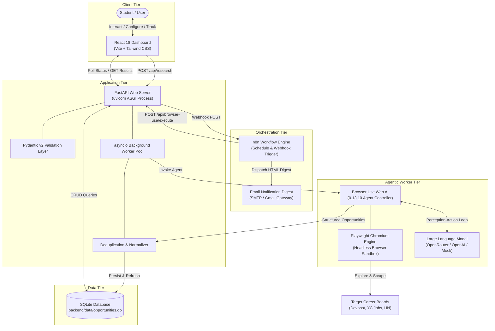

# Opportunity Hunter AI — System Architecture & Data Flow

This document details the complete technical architecture of **Opportunity Hunter AI**, explaining how every component coordinates to discover, process, store, and display opportunities.

---

## 1. High-Level Architecture Diagram



---

## 2. Core Component Roles & Responsibilities

### 1. The User
- Initiates search queries by configuring technical skills (`Python`, `React`, etc.), category types (`internship`, `hackathon`), location, and experience.
- Reviews discovered listings on the dashboard, bookmarks favorites, and moves applications through pipeline stages (`interested`, `applied`, `rejected`).

### 2. React Frontend (`frontend/src/`)
- **Technology**: React 18, Vite, Tailwind CSS, Lucide React, React Router.
- **Role**: Presents the user interface, validates form inputs on the client side, initiates asynchronous HTTP requests, executes periodic non-blocking polling, and provides optimistic UI updates for tracking actions.

### 3. FastAPI Backend (`backend/app/`)
- **Technology**: Python 3.14 / 3.11+, FastAPI 0.142+, Pydantic v2, Starlette.
- **Role**: Acts as the central nervous system. Enforces strict type validation on inputs, manages SQLite connections, coordinates asynchronous background execution pools, communicates with n8n webhooks, and serves REST API endpoints.

### 4. Browser Use Web AI (`backend/app/agents/`)
- **Technology**: `browser-use` 0.13.10.
- **Role**: The cognitive agent that perceives webpage DOM trees, computes interactive accessibility nodes, plans multi-step navigation paths, and extracts structured listings conforming to the Pydantic output schema.

### 5. Playwright Chromium Engine
- **Technology**: Playwright 1.63.
- **Role**: The headless execution engine that renders client-side JavaScript, executes mouse clicks and keyboard typing, handles redirects, and captures DOM states on behalf of Browser Use.

### 6. Large Language Model (LLM)
- **Technology**: Configurable via OpenRouter (`meta-llama/llama-3.3-70b-instruct`, `deepseek/deepseek-r1`) or OpenAI (`gpt-4o-mini`).
- **Role**: Performs high-level semantic reasoning. Analyzes web text, distinguishes senior roles from junior co-ops, extracts clean company names, and formats outputs into JSON schemas.

### 7. n8n Workflow Engine (`n8n/workflows/`)
- **Technology**: n8n Workflow Automation.
- **Role**: Manages macro-level scheduling and notifications. Runs daily 8:00 AM cron tasks, fetches user preferences from FastAPI, orchestrates research requests, filters newly discovered records, and sends formatted HTML email digests.

### 8. SQLite Database (`backend/app/database/`)
- **Technology**: SQLite 3.50+ (`opportunities.db`).
- **Role**: Persistent local storage. Stores indexed opportunity records, execution run histories, and default user preferences with full ACID transaction guarantees.

### 9. Deduplication & Normalization Service (`backend/app/services/`)
- **Technology**: Python `urllib.parse` + regular expressions.
- **Role**: Strips URL tracking parameters, checks for existing records by URL or fuzzy title/company matching, and enforces the **Status Preservation Guarantee** so existing user tracking statuses are never overwritten.

---

## 3. End-to-End Information Lifecycle (How Data Travels)

Let's trace how a search request for `Skills: ["Python", "React"]`, `Type: "internship"`, `Location: "Remote"` travels through the system:

```
[User clicks "Find Opportunities"]
               │
               ▼
1. React Client Validation (DiscoverPage.jsx)
   - Verifies selectedSkills.length > 0
   - Constructs JSON payload
               │
               ▼
2. HTTP POST to /api/research (FastAPI)
   - Pydantic validates payload against ResearchRequest schema
   - Creates new ResearchRun record in SQLite (status: RUNNING)
   - Returns HTTP 202 Accepted with run_id in <10ms
               │
               ▼
3. Non-Blocking Background Offload
   - React starts 1.2s interval polling GET /api/research/{run_id}
   - FastAPI spawns background asyncio task
               │
               ▼
4. Autonomous Agent Execution (browser_researcher.py)
   - Browser Use launches Playwright Chromium (headless)
   - Navigates to target opportunity boards
   - LLM inspects DOM accessibility tree, evaluates search inputs
   - Extracts structured listings into OpportunityListOutput
               │
               ▼
5. Normalization & Deduplication (deduplication.py)
   - Strips UTM marketing tokens from application URLs
   - Checks SQLite for existing matches
   - If duplicate found: refreshes discovered_at date, keeps user's status (e.g. APPLIED)
   - If new: creates fresh Opportunity entity (status: NEW)
               │
               ▼
6. SQLite Commit & Run Completion
   - Writes records to opportunities table
   - Updates research_runs table (status: COMPLETED, results_count: N)
               │
               ▼
7. Client Poller Detects Completion
   - Next poll to /api/research/{run_id} returns status: COMPLETED
   - React halts polling, advances stepper to "Sync Complete"
   - React fetches GET /api/opportunities?limit=10 and renders interactive cards
```

---

## 4. Conceptual Engineering Comparisons

### A. Traditional Automation vs. AI Agents

| Dimension | Traditional Automation (e.g. Cron scripts) | AI Agent (Opportunity Hunter AI) |
|---|---|---|
| **Flexibility** | Rigid: breaks if any HTML tag or DOM selector changes. | Adaptive: understands natural language semantics on any webpage. |
| **Logic** | Explicit hardcoded rules (`if button.id == 'submit': click()`). | Cognitive reasoning (`"Find the button that opens the application form"`). |
| **Data Extraction** | Brittle regex and CSS queries. | Semantic schema-enforced entity extraction via LLMs. |

---

### B. Browser Automation vs. API-Based Data Retrieval

| Dimension | API-Based Retrieval | Browser Automation (Playwright / Browser Use) |
|---|---|---|
| **Speed** | Milliseconds. | Seconds (must launch browser and load DOM). |
| **Availability** | Only works if the target company provides a public API. | Works on **any** public website accessible to human users. |
| **Fragility** | Stable API contracts. | Susceptible to dynamic bot protections and CAPTCHAs. |
| **Our Approach** | Opportunity Hunter uses APIs internally (FastAPI/n8n) and Browser Automation externally for target web scraping. |

---

### C. Large Language Model (LLM) vs. AI Agent

| Dimension | Large Language Model (LLM) | AI Agent |
|---|---|---|
| **What it is** | A neural network model (next-token predictor). | A software architecture wrapped around an LLM. |
| **Capabilities** | Generates text, code, or structured JSON when prompted. | Perceives state, invokes external tools, navigates browsers, and writes to databases. |
| **Autonomy** | Passive (single input $\rightarrow$ single output). | Active (loops through multi-step decisions until a goal is met). |

---

### D. Workflow Automation vs. Autonomous Agent

| Dimension | Workflow Automation (n8n) | Autonomous Agent (Browser Use) |
|---|---|---|
| **Nature** | Deterministic pipeline of predefined steps. | Dynamic, exploratory reasoning loop. |
| **Best For** | Scheduled triggers, routing data, conditional logic, notifications. | Navigating unfamiliar websites, parsing unstructured web content. |
| **Synergy** | **n8n acts as the manager** (when and where data moves); **Browser Use acts as the worker** (explores the web). |

---

### E. Frontend, Backend, and Database

- **Frontend (React)**: What the user sees and clicks. Lives entirely in the client's browser. Knows nothing about database queries or secret API keys.
- **Backend (FastAPI)**: The server-side engine. Validates requests, manages authentication, controls browser processes, and holds secret API keys securely.
- **Database (SQLite)**: The permanent state storage. Retains user records even when the server shuts down or restarts.

---

### F. Synchronous vs. Asynchronous Operations

- **Synchronous**: Blocks execution until the task finishes.
  - *Example*: Checking input validation (`if len(skills) == 0`). Happens in microseconds; the user doesn't wait.
- **Asynchronous**: Starts a long-running task in the background and frees the server immediately to handle other requests.
  - *Example*: Browser automation takes 30 seconds. FastAPI returns HTTP 202 immediately and processes the agent asynchronously, preventing server timeouts.

---

## 5. What Is Genuinely AI-Driven vs. Conventional Logic?

In technical interviews, clearly distinguishing AI components from traditional software logic demonstrates deep technical maturity:

### Genuinely AI-Driven Components:
1. **Interactive Element Selection**: Browser Use uses an LLM to interpret accessibility tree nodes and decide which interactive elements to click or input text into.
2. **Semantic Entity Extraction**: An LLM reads messy, unstructured job descriptions and extracts structured fields (`title`, `organization`, `required_skills`, `deadline`).
3. **Structured Schema Adherence**: The LLM outputs typed JSON mapped to our Pydantic `OpportunityListOutput` model.

### Conventional Software Logic Components:
1. **URL Normalization**: Pure deterministic string parsing using Python's `urllib.parse` and regular expressions.
2. **Status Preservation & Deduplication**: Relational SQL queries checking URL and title existence.
3. **Database CRUD**: Standard SQLite queries (`INSERT`, `SELECT`, `UPDATE`).
4. **API Routing & Middleware**: FastAPI routing, CORS handling, and HTTP status code dispatch.
5. **Workflow Scheduling**: n8n cron triggers and webhook listener nodes.
6. **Frontend UI State**: React hooks (`useState`, `useEffect`) and Tailwind CSS styling.
